# Database Layout

> _Auto-generated from SQLModel metadata on 2026-10-30._

This page documents the LibrisLog database schema. It is intended for
developers who need to understand the data model, write queries, or extend
the application.

```mermaid
erDiagram

    user ||--|{ apikey : "1:N"
    user ||--|{ author : "1:N"
    user ||--o{ book : "0..N"
    user ||--|{ embed_token : "1:N"
    user ||--|{ import_mapping : "1:N"
    user ||--|| oidclink : "1:1"
    user ||--|{ public_profile_link : "1:N"
    user ||--|{ tag : "1:N"
    user ||--|{ user_image : "1:N"
    user ||--|| usersettings : "1:1"
    book ||--|{ book_author : "1:N"
    author ||--|{ book_author : "1:N"
    book ||--|{ book_tag : "1:N"
    tag ||--|{ book_tag : "1:N"
    book ||--|{ reading_progress : "1:N"
    user ||--|{ reading_progress : "1:N"
    book ||--|{ reading_session : "1:N"
    user ||--|{ reading_session : "1:N"

    installation_info {
        integer id PK
        varchar(64) installation_id
        datetime created_at
        datetime updated_at
    }

    user {
        integer id PK
        varchar firstname
        varchar lastname
        varchar email UK
        varchar role
        varchar avatar_source
        varchar hashed_password
        integer credentials_version
        datetime created_at
        datetime updated_at
    }

    apikey {
        integer id PK
        integer user_id
        varchar key_prefix
        varchar key_hash UK
        varchar key_encrypted
        varchar description
        datetime created_at
        datetime last_used_at
        datetime revoked_at
    }

    author {
        integer id PK
        integer user_id
        varchar name
        datetime created_at
    }

    book {
        integer id PK
        varchar title
        varchar subtitle
        varchar isbn
        varchar cover_url
        varchar publisher
        integer published_year
        integer page_count
        varchar(2) language
        varchar notes
        varchar blurb
        integer rating
        varchar reading_status
        varchar acquisition_status
        varchar medium
        integer user_id
        datetime date_added
        datetime date_started
        datetime date_finished
    }

    embed_token {
        integer id PK
        integer user_id
        varchar(255) name
        varchar token_prefix
        varchar token_hash UK
        varchar scopes
        varchar allowed_origins
        datetime expires_at
        datetime last_used_at
        datetime created_at
        datetime revoked_at
    }

    import_mapping {
        integer id PK
        integer user_id
        varchar(255) name
        varchar(64) schema_fingerprint
        varchar source_fields_json
        varchar mapping_json
        datetime created_at
        datetime updated_at
    }

    oidclink {
        integer id PK
        integer user_id UK
        varchar provider_id
        varchar oidc_sub UK
        varchar oidc_email
        varchar oidc_name
        datetime linked_at
    }

    public_profile_link {
        integer id PK
        integer user_id
        varchar(255) name
        varchar token_prefix
        varchar token
        varchar token_hash UK
        varchar audience
        varchar language
        text visibility_config_json
        datetime expires_at
        datetime created_at
        datetime revoked_at
    }

    tag {
        integer id PK
        integer user_id
        varchar name
        datetime created_at
    }

    user_image {
        integer id PK
        integer user_id
        varchar kind
        varchar variant
        varchar filename
        varchar external_url
        varchar content_type
        integer byte_size
        datetime created_at
        datetime updated_at
    }

    usersettings {
        integer id PK
        integer user_id UK
        varchar(10) language
        varchar(64) timezone
        varchar(20) theme
        varchar(30) custom_theme
        boolean goal_pages_per_day_enabled
        integer goal_pages_per_day
        boolean goal_pages_per_month_enabled
        integer goal_pages_per_month
        boolean goal_books_per_month_enabled
        integer goal_books_per_month
        boolean goal_books_per_year_enabled
        integer goal_books_per_year
        boolean gamification_enabled
        boolean auto_set_date_started
        boolean auto_set_date_finished
        varchar(20) statistics_range
        date statistics_custom_from
        date statistics_custom_to
    }

    book_author {
        integer book_id PK
        integer author_id PK
    }

    book_tag {
        integer book_id PK
        integer tag_id PK
    }

    reading_progress {
        integer id PK
        integer book_id
        integer user_id
        integer session_id
        integer page
        datetime created_at
        datetime updated_at
    }

    reading_session {
        integer id PK
        integer book_id
        integer user_id
        varchar status
        datetime date_started
        datetime date_finished
        boolean is_current
        datetime created_at
        datetime updated_at
    }

```

## Tables

### `installation_info`

Singleton row storing the anonymous installation id for telemetry.

The id is a random UUIDv4 generated on first startup and persisted in the
database so it stays stable across container restarts and updates. It is
never derived from any machine-specific identifier.

| Column | Type | Constraints | Notes |
|--------|------|-------------|-------|
| `id` | `INTEGER` | PK | Auto-increment; default 1 |
| `installation_id` | `VARCHAR(64)` | NOT NULL |  |
| `created_at` | `DATETIME` |  | UTC |
| `updated_at` | `DATETIME` |  | UTC |

### `user`

A user account.

| Column | Type | Constraints | Notes |
|--------|------|-------------|-------|
| `id` | `INTEGER` | PK | Auto-increment |
| `firstname` | `VARCHAR` | NOT NULL |  |
| `lastname` | `VARCHAR` | NOT NULL |  |
| `email` | `VARCHAR` | UNIQUE, NOT NULL |  |
| `role` | `VARCHAR` | NOT NULL, INDEX | default `user` |
| `avatar_source` | `VARCHAR` | NOT NULL, INDEX | default `animal` |
| `hashed_password` | `VARCHAR` | NOT NULL |  |
| `credentials_version` | `INTEGER` | NOT NULL | default 0 |
| `created_at` | `DATETIME` |  | UTC |
| `updated_at` | `DATETIME` |  | UTC |

### `apikey`

API key for programmatic access.

| Column | Type | Constraints | Notes |
|--------|------|-------------|-------|
| `id` | `INTEGER` | PK | Auto-increment |
| `user_id` | `INTEGER` | FK → user.id, NOT NULL, INDEX |  |
| `key_prefix` | `VARCHAR` | NOT NULL, INDEX |  |
| `key_hash` | `VARCHAR` | UNIQUE, NOT NULL |  |
| `key_encrypted` | `VARCHAR` |  |  |
| `description` | `VARCHAR` |  |  |
| `created_at` | `DATETIME` |  | UTC |
| `last_used_at` | `DATETIME` |  | UTC |
| `revoked_at` | `DATETIME` |  | UTC |

### `author`

A user-specific author name that can be associated with books.

| Column | Type | Constraints | Notes |
|--------|------|-------------|-------|
| `id` | `INTEGER` | PK | Auto-increment |
| `user_id` | `INTEGER` | FK → user.id, NOT NULL, INDEX |  |
| `name` | `VARCHAR` | NOT NULL, INDEX |  |
| `created_at` | `DATETIME` |  | UTC |

**Unique constraint:** `(user_id, name)`: uq_author_user_id_name

### `book`

A book in the user's library.

| Column | Type | Constraints | Notes |
|--------|------|-------------|-------|
| `id` | `INTEGER` | PK | Auto-increment |
| `title` | `VARCHAR` | NOT NULL, INDEX |  |
| `subtitle` | `VARCHAR` |  |  |
| `isbn` | `VARCHAR` |  |  |
| `cover_url` | `VARCHAR` |  |  |
| `publisher` | `VARCHAR` |  |  |
| `published_year` | `INTEGER` |  |  |
| `page_count` | `INTEGER` | NOT NULL | default 0 |
| `language` | `VARCHAR(2)` |  |  |
| `notes` | `VARCHAR` |  |  |
| `blurb` | `VARCHAR` |  |  |
| `rating` | `INTEGER` |  | ≥ 1; ≤ 5 |
| `reading_status` | `VARCHAR` | NOT NULL, INDEX | default `want_to_read` |
| `acquisition_status` | `VARCHAR` | NOT NULL, INDEX | default `owned` |
| `medium` | `VARCHAR` | INDEX |  |
| `user_id` | `INTEGER` | FK → user.id, INDEX |  |
| `date_added` | `DATETIME` | INDEX | UTC |
| `date_started` | `DATETIME` | INDEX | UTC |
| `date_finished` | `DATETIME` | INDEX | UTC |

**Unique constraint:** `(user_id, isbn)`: uq_book_user_id_isbn

### `embed_token`

A scoped embed token for iframe/dashboard integrations.

| Column | Type | Constraints | Notes |
|--------|------|-------------|-------|
| `id` | `INTEGER` | PK | Auto-increment |
| `user_id` | `INTEGER` | FK → user.id, NOT NULL, INDEX |  |
| `name` | `VARCHAR(255)` | NOT NULL |  |
| `token_prefix` | `VARCHAR` | NOT NULL, INDEX |  |
| `token_hash` | `VARCHAR` | UNIQUE, NOT NULL |  |
| `scopes` | `VARCHAR` | NOT NULL | default `embed:stats:read` |
| `allowed_origins` | `VARCHAR` |  |  |
| `expires_at` | `DATETIME` |  | UTC |
| `last_used_at` | `DATETIME` |  | UTC |
| `created_at` | `DATETIME` |  | UTC |
| `revoked_at` | `DATETIME` |  | UTC |

### `import_mapping`

A saved column-mapping configuration for data import.

| Column | Type | Constraints | Notes |
|--------|------|-------------|-------|
| `id` | `INTEGER` | PK | Auto-increment |
| `user_id` | `INTEGER` | FK → user.id, NOT NULL, INDEX |  |
| `name` | `VARCHAR(255)` | NOT NULL |  |
| `schema_fingerprint` | `VARCHAR(64)` | NOT NULL, INDEX |  |
| `source_fields_json` | `VARCHAR` | NOT NULL |  |
| `mapping_json` | `VARCHAR` | NOT NULL |  |
| `created_at` | `DATETIME` |  | UTC |
| `updated_at` | `DATETIME` |  | UTC |

**Unique constraint:** `(user_id, name)`: uq_import_mapping_user_id_name

### `oidclink`

Links an OIDC identity to a local user account.

| Column | Type | Constraints | Notes |
|--------|------|-------------|-------|
| `id` | `INTEGER` | PK | Auto-increment |
| `user_id` | `INTEGER` | FK → user.id, UNIQUE, NOT NULL |  |
| `provider_id` | `VARCHAR` | NOT NULL, INDEX |  |
| `oidc_sub` | `VARCHAR` | UNIQUE, NOT NULL |  |
| `oidc_email` | `VARCHAR` |  |  |
| `oidc_name` | `VARCHAR` |  |  |
| `linked_at` | `DATETIME` |  | UTC |

### `public_profile_link`

A shareable public profile link owned by a user.

| Column | Type | Constraints | Notes |
|--------|------|-------------|-------|
| `id` | `INTEGER` | PK | Auto-increment |
| `user_id` | `INTEGER` | FK → user.id, NOT NULL, INDEX |  |
| `name` | `VARCHAR(255)` | NOT NULL |  |
| `token_prefix` | `VARCHAR` | NOT NULL, INDEX |  |
| `token` | `VARCHAR` |  |  |
| `token_hash` | `VARCHAR` | UNIQUE, NOT NULL |  |
| `audience` | `VARCHAR` | NOT NULL | default `public` |
| `language` | `VARCHAR` |  |  |
| `visibility_config_json` | `TEXT` |  | default `{}` |
| `expires_at` | `DATETIME` |  | UTC |
| `created_at` | `DATETIME` |  | UTC |
| `revoked_at` | `DATETIME` |  | UTC |

### `tag`

A user-specific tag that can be applied to books.

| Column | Type | Constraints | Notes |
|--------|------|-------------|-------|
| `id` | `INTEGER` | PK | Auto-increment |
| `user_id` | `INTEGER` | FK → user.id, NOT NULL, INDEX |  |
| `name` | `VARCHAR` | NOT NULL, INDEX |  |
| `created_at` | `DATETIME` |  | UTC |

**Unique constraint:** `(user_id, name)`: uq_tag_user_id_name

### `user_image`

A locally cached or uploaded image owned by a user.

| Column | Type | Constraints | Notes |
|--------|------|-------------|-------|
| `id` | `INTEGER` | PK | Auto-increment |
| `user_id` | `INTEGER` | FK → user.id, NOT NULL, INDEX |  |
| `kind` | `VARCHAR` | NOT NULL, INDEX | default `avatar` |
| `variant` | `VARCHAR` | NOT NULL, INDEX |  |
| `filename` | `VARCHAR` |  |  |
| `external_url` | `VARCHAR` |  |  |
| `content_type` | `VARCHAR` |  |  |
| `byte_size` | `INTEGER` |  |  |
| `created_at` | `DATETIME` | NOT NULL | UTC |
| `updated_at` | `DATETIME` | NOT NULL | UTC |

**Unique constraint:** `(user_id, kind, variant)`: uq_user_image_user_kind_variant

### `usersettings`

Per-user settings such as language, timezone, and theme.

| Column | Type | Constraints | Notes |
|--------|------|-------------|-------|
| `id` | `INTEGER` | PK | Auto-increment |
| `user_id` | `INTEGER` | FK → user.id, UNIQUE, NOT NULL |  |
| `language` | `VARCHAR(10)` | NOT NULL | default `en` |
| `timezone` | `VARCHAR(64)` | NOT NULL | default `UTC` |
| `theme` | `VARCHAR(20)` | NOT NULL | default `light` |
| `custom_theme` | `VARCHAR(30)` |  |  |
| `goal_pages_per_day_enabled` | `BOOLEAN` | NOT NULL | default False |
| `goal_pages_per_day` | `INTEGER` | NOT NULL | default 20; ≥ 1 |
| `goal_pages_per_month_enabled` | `BOOLEAN` | NOT NULL | default False |
| `goal_pages_per_month` | `INTEGER` | NOT NULL | default 300; ≥ 1 |
| `goal_books_per_month_enabled` | `BOOLEAN` | NOT NULL | default False |
| `goal_books_per_month` | `INTEGER` | NOT NULL | default 2; ≥ 1 |
| `goal_books_per_year_enabled` | `BOOLEAN` | NOT NULL | default False |
| `goal_books_per_year` | `INTEGER` | NOT NULL | default 25; ≥ 1 |
| `gamification_enabled` | `BOOLEAN` | NOT NULL | default True |
| `auto_set_date_started` | `BOOLEAN` | NOT NULL | default True |
| `auto_set_date_finished` | `BOOLEAN` | NOT NULL | default True |
| `statistics_range` | `VARCHAR(20)` | NOT NULL | default `alltime` |
| `statistics_custom_from` | `DATE` |  |  |
| `statistics_custom_to` | `DATE` |  |  |

### `book_author`

Many-to-many association between books and authors.

| Column | Type | Constraints | Notes |
|--------|------|-------------|-------|
| `book_id` | `INTEGER` | PK, FK → book.id |  |
| `author_id` | `INTEGER` | PK, FK → author.id |  |

### `book_tag`

Many-to-many association between books and tags.

| Column | Type | Constraints | Notes |
|--------|------|-------------|-------|
| `book_id` | `INTEGER` | PK, FK → book.id |  |
| `tag_id` | `INTEGER` | PK, FK → tag.id |  |

### `reading_progress`

A page-number reading progress entry for a book.

| Column | Type | Constraints | Notes |
|--------|------|-------------|-------|
| `id` | `INTEGER` | PK | Auto-increment |
| `book_id` | `INTEGER` | FK → book.id, NOT NULL, INDEX |  |
| `user_id` | `INTEGER` | FK → user.id, NOT NULL, INDEX |  |
| `session_id` | `INTEGER` | INDEX |  |
| `page` | `INTEGER` | NOT NULL | ≥ 0 |
| `created_at` | `DATETIME` |  | UTC |
| `updated_at` | `DATETIME` |  | UTC |

### `reading_session`

A single reading period (first read, re-read, etc.) of a book.

``Book.date_started`` / ``Book.date_finished`` remain a denormalized mirror
of the *current* session (``is_current=True``), or of the latest session when
none is current, so every existing consumer keeps working unchanged. A book
with a single session therefore behaves identically to the pre-session model.

At most one current session exists per book (enforced by a partial unique
index on ``is_current`` and by the service layer).

| Column | Type | Constraints | Notes |
|--------|------|-------------|-------|
| `id` | `INTEGER` | PK | Auto-increment |
| `book_id` | `INTEGER` | FK → book.id, NOT NULL, INDEX |  |
| `user_id` | `INTEGER` | FK → user.id, NOT NULL, INDEX |  |
| `status` | `VARCHAR` | NOT NULL, INDEX |  |
| `date_started` | `DATETIME` | INDEX | UTC |
| `date_finished` | `DATETIME` | INDEX | UTC |
| `is_current` | `BOOLEAN` | NOT NULL, INDEX | default False |
| `created_at` | `DATETIME` |  | UTC |
| `updated_at` | `DATETIME` |  | UTC |

## Enums

### `AcquisitionStatus`

| Value | Meaning |
|-------|---------|
| `owned` | Owned |
| `borrowed` | Borrowed |
| `digital_access` | Digital Access |
| `to_acquire` | To Acquire |

### `AvatarSource`

| Value | Meaning |
|-------|---------|
| `animal` | Animal |
| `oidc` | Oidc |
| `upload` | Upload |

### `Medium`

| Value | Meaning |
|-------|---------|
| `Print` | Print |
| `eBook` | Ebook |
| `Audiobook` | Audiobook |
| `Comic / Graphic Novel` | Comic / Graphic Novel |
| `Magazine / Newspaper` | Magazine / Newspaper |

### `PublicProfileAudience`

| Value | Meaning |
|-------|---------|
| `public` | Public |
| `authenticated` | Authenticated |

### `ReadingStatus`

| Value | Meaning |
|-------|---------|
| `want_to_read` | Want To Read |
| `currently_reading` | Currently Reading |
| `read` | Read |
| `did_not_finish` | Did Not Finish |

### `UserRole`

| Value | Meaning |
|-------|---------|
| `admin` | Admin |
| `user` | User |

## Conventions

- **Timestamps** are stored as UTC via the `UtcDateTime` type decorator.
  Values are stored as naive UTC in SQLite and returned as timezone-aware
  `datetime` objects by the application.
- **Soft deletes** — `ApiKey` and `EmbedToken` use a `revoked_at` timestamp
  instead of `DELETE`. Revoked entries are excluded from all queries.
- **Foreign keys** — all user-owned tables reference `user.id` via foreign
  key constraints. Cascading behavior is handled in application code (not
  at the database level).
- **Unique constraints**: compound constraints like `(user_id, isbn)` on
  `book` and `(user_id, name)` on `tag` enforce per-user uniqueness without
  restricting other users.
